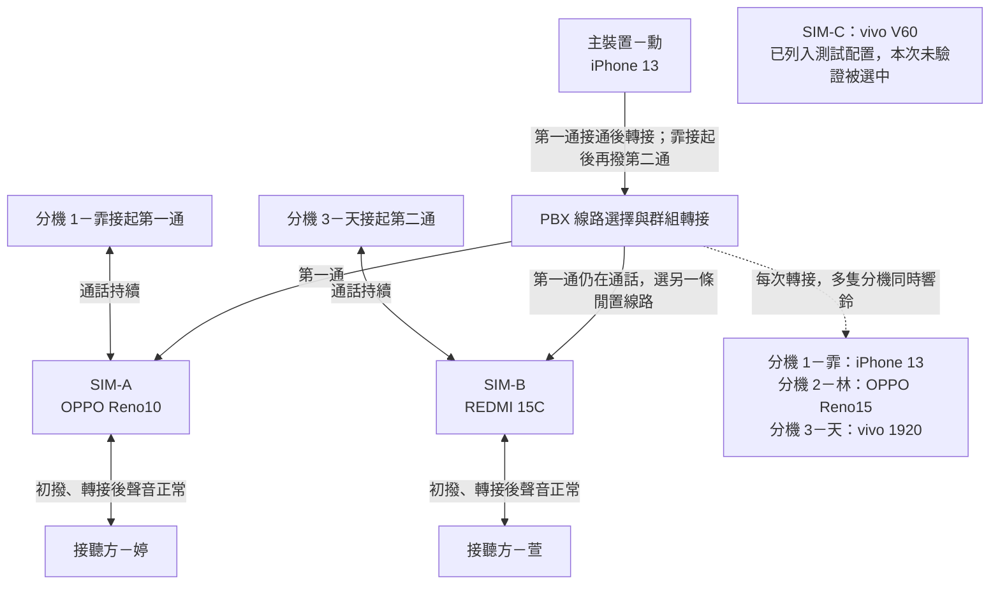
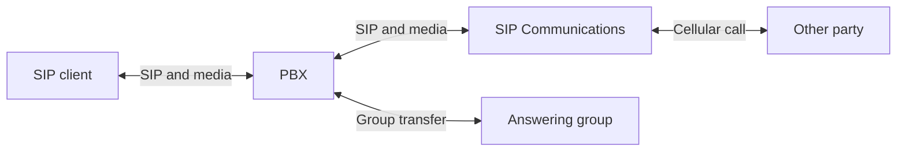

# QQ-SIP / SIP通訊

Use a SIM-equipped Android phone as a cellular gateway for a SIP phone system. A SIP client such as Linphone or Bria sends an outbound call through the PBX, and the Android phone places it on the mobile network. The same bridge can carry an incoming mobile call back to the SIP system when the routing policy allows it.

QQ-SIP builds on sparkcyf's [Voice SIP Agent](https://github.com/sparkcyf/android-voice-sip-agent). This is the single repository for QQ-SIP source, documentation and APK releases. The standalone APK accepts SIP settings directly on the phone or from an account QR code. The earlier platform-managed build is available as a separate build variant. A compatible PBX can coordinate line selection, group ringing, and transfers across several SIM phones. Each Android handset handles one cellular call at a time.

[Development history](#development-history) · [Source review](docs/SOURCE_REVIEW.md) · [Testing](docs/TESTING.md) · [Changelog](CHANGELOG.md) · [Third-party notices](THIRD_PARTY_NOTICES.md)

## Development history

1. **Starting with the call bridge.** The first versions adapted Voice SIP Agent for centrally managed handsets. The Android gateway gained a localized setup flow and received its SIP settings from the platform, so each SIM phone could be prepared without entering its SIP configuration by hand.
2. **Getting handsets ready.** Early changes made it possible to retry Android permission requests, reconnect from the home screen, and see Shizuku readiness separately from the platform session. Session renewal was later added for handsets that stay online.
3. **Working through call and audio issues.** Early device calls confirmed two-way audio, hang-up, and in-call keypad tones in the setups tested. Reports of one-way audio led to separate counters for each direction and a direct-telephony audio preset. The preset leaves the handset speaker or earpiece audible, so local muting is a separate test.
4. **Operating multiple SIM phones.** The Android client added readiness and call-event reporting, and retained received SMS locally until the server acknowledged it. The platform and PBX handle fixed and shared lines, group ringing, and transfers. The public source snapshot also passed 42 SIP and gateway tests. [Changelog](CHANGELOG.md) · [Device and automated test notes](docs/TESTING.md)

### Single-app startup

Standalone.2 integrates wireless-debugging pairing and call-service startup on Android 12+ primary users, using LibADB Android, Conscrypt, and Bouncy Castle. Other supported environments retain the external Shizuku path. It includes discovery recovery and callback ownership fixes from the private single-app development line.

A separate earlier candidate completed one two-way call on a REDMI 15C. That result does not constitute handset acceptance of this public APK. [Test scope](docs/TESTING.md)

## Current progress

| Workstream | Status |
| --- | --- |
| Single-app startup | Included in standalone.2 for Android 12+ primary users; pair once and start the service again after reboot. [Setup](docs/SIP_QR.md) |
| SIP setup by QR code | Scan a supported SIP account QR to save settings and request login. Permissions and the call service must be ready. [QR formats](docs/SIP_QR.md) |
| Multi-SIM selection and group transfer | Reported working in a two-call trial. The first call stayed on SIM A after transfer. The second call used SIM B and stayed on SIM B when another extension answered. [Call sequence and results](docs/TESTING.md#multi-sim-and-group-transfer-trial) |
| Multi-VPS mode | Next research stage. Architecture, cross-VPS routing, state coordination and failure recovery have not been implemented or validated by this release. |

### 當前進度與雙通話測試

1. **單一 APP 啟動可行**：Android 12 以上主要使用者可在 QQ-SIP 內完成無線偵錯配對及啟動，不必另外開啟 Shizuku；其他環境保留 Shizuku 路徑。新版公開 APK 的實機通話仍待驗收。
2. **掃描 QR Code 登入 SIP**：已加入帳號 QR 掃描與匯入，使用同一套 SIP 登入流程；需先完成權限及通話服務設定。
3. **多卡輪替／群組轉接**：使用者回報第一通由 SIM-A 保持通話，第二通改用 SIM-B，兩通轉接後聲音正常。這證明該次測試使用了兩條不同線路，不代表已驗證 A→B→C 的完整輪替演算法。

以下為使用者回報的兩通重疊通話；第二通使用 SIM-B 已再次確認。分機同時響鈴、初撥及轉接後通話均回報正常。[完整人員、手機與六項結果](docs/TESTING.md#multi-sim-and-group-transfer-trial)



**下一步：研究多 VPS 模式。** 本次更新只記錄研究方向，未宣稱已完成跨主機路由、故障切換或部署。

## Requirements

- An ARM64 Android phone running Android 11 or later, with a SIM that supports voice calls.
- Android 12+ primary user: use the in-app **Pair and start service** flow. Android 11 or a secondary user: [Shizuku](https://github.com/RikkaApps/Shizuku) must be installed, running, and authorized.
- A SIP PBX account and a SIP client for the calling or answering side.

The first public source snapshot was `0.4.0-yx.12`. The new edition is `0.4.0-standalone.2` (version code 2), named **SIP通訊** in Chinese and **QQ-SIP** in English. Previous releases remain available. Relevant intervening changes are consolidated into this version; no unbuilt intermediate APKs are presented as releases.

## Set up a handset

1. Download the signed [QQ-SIP.apk](https://github.com/AetherKoda/sip-android-gateway/releases/tag/v0.4.0-standalone.2) and install it on an ARM64 Android phone.
2. Open **Pair and start service**, follow the notification pairing instructions, and start the call service. On the fallback path, start and authorize Shizuku. Follow the app prompts for notifications, phone access, and the default phone role. The standalone edition does not request the SMS role.
3. Enter the SIP domain/server, username and password, then select **Log in to SIP**; alternatively scan a [supported account QR](docs/SIP_QR.md). Port, transport, and optional settings remain configurable.
4. Wait for **SIP registered**, then place an authorized test call and check both audio directions and hang-up.

After every reboot, enable wireless debugging and start the call service again (or restart Shizuku on the fallback path). Standalone.2 uses the new package `io.github.aetherkoda.qqsip` and an existing maintainer signing identity because the standalone.1 key was unavailable. It installs alongside standalone.1 and managed YX; it cannot update either package in place. Stop the old app before using the same SIP account in QQ-SIP.

The release has R8 optimization and an AES-256-GCM encrypted DEX loader. [Packaging source and limitations](tools/protection/README.md) are included. This protects code at rest but is not a guarantee against reverse engineering and does not encrypt SIP/RTP traffic. No managed server URL or deployment IP is configured in the standalone APK; the loopback address used for on-device debugging is intentional.

## Routing and configuration



- **Fixed line.** The PBX assigns a specific SIM handset. That handset stays busy through a transfer until the cellular call ends.
- **Shared lines.** With the corresponding PBX policy, another idle SIM handset can carry a new call after a transfer is answered. The first handset continues to carry the original call.
- **Group ringing.** The configured PBX controls who rings, how waiting calls queue, and when the remaining phones stop ringing after an answer.
- **Incoming calls.** The standalone handset forwards them to the SIP extension configured in the app. If the extension is blank, incoming calls are rejected while the gateway is active.

| Setting | What it does |
| --- | --- |
| SIP account | Enter the server, credentials, and transport supplied by your PBX administrator. |
| SIP transport and media | The PBX must agree with the app's transport and SRTP policy. A UDP compatibility profile can still carry unencrypted media. |
| Outbound SIM | Use the default or select a SIM slot. The gateway handles one active cellular call per handset. |
| Audio compatibility | The compatibility preset uses direct telephony audio and leaves handset output audible. Test handset muting separately. |
| Reconnect | Request a reconnect, then wait for SIP registration to confirm recovery. |

## Troubleshooting

| Symptom | What to check |
| --- | --- |
| Call service is unavailable | Use **Pair and start service**, keep the system pairing-code dialog open during pairing, and wait for local debugging discovery. On the fallback path, check Shizuku authorization. If the app reports a timed-out operation, follow its force-stop instructions before retrying. |
| Calls connect but audio is one-way | Check microphone permission and mute on the SIP client. Try the appropriate audio mode and compare per-direction audio counters while both people speak. |
| SIP certificate name mismatch | Match the SIP server name to the certificate and keep certificate verification enabled. |
| SIP 488 | Check the codecs and media-encryption policy on both ends. |
| Transfer fails | Check that the target group is configured on the PBX and that its SIP clients are registered. |

The readiness indicators cover setup and registration. Check actual two-way audio during a connected call. An audio peak in a single diagnostic sample can reflect sound from earlier in the call. Compare counters over an interval while both parties speak.

The managed edition can keep received SMS in an outbox until the expected acknowledgement arrives. The standalone edition leaves SMS with the device’s current SMS app. Keep account details and raw device logs out of public issue reports.

## Device testing

Physical call tests were reported successful on **OPPO Reno10**, **OPPO Reno15**, and **vivo V60**. Results depend on the Android build, carrier, and audio settings used. Check both audio directions on the intended handset and network. The [testing notes](docs/TESTING.md) record the test scope and the scenarios that still need coverage.

## Build from source

Use JDK 17 or newer, Android SDK 37, the Android NDK required by the native script, SWIG, and the native build tools. Generate the ARM64 PJSUA2 bindings before assembling the app. This project uses the upstream build flow and targets ARM64 in its Android configuration. [Upstream build instructions](https://github.com/sparkcyf/android-voice-sip-agent/blob/2e2c46ccaeda1aa2e2c129d42b4084b5a0a45a13/README.md#building-from-source)

```bash
ABIS=arm64-v8a APP_PLATFORM=android-30 ./sip-pjsua2/native/build-pjsua2.sh
./gradlew :app:assembleStandaloneDebug
```

The standalone build uses the SIP settings entered on the handset. To run the app, SIP, and bridge tests, use `./gradlew :app:testStandaloneDebugUnitTest :app:testManagedDebugUnitTest :sip:test :gateway:test`.

## Open-source components

| Component | Role | License |
| --- | --- | --- |
| [Voice SIP Agent](https://github.com/sparkcyf/android-voice-sip-agent) | Android gateway and call bridge | GPL-2.0-or-later with an Apache 2.0 linking exception |
| [Shizuku](https://github.com/RikkaApps/Shizuku) | Separately installed service for privileged call integration and audio access | Apache-2.0 |
| [Shizuku API / Provider 13.1.5](https://github.com/RikkaApps/Shizuku-API) | Client interface to Shizuku | [MIT](LICENSES/Shizuku-API-MIT.txt) |
| [PJSIP / PJSUA2 2.17](https://github.com/pjsip/pjproject) | SIP signaling and call media | GPL-2.0-or-later |
| [libsrtp](https://github.com/cisco/libsrtp) | Secure RTP, supplied with pjproject | BSD-3-Clause |
| [OpenSSL 3.5.9](https://github.com/openssl/openssl) | TLS and cryptography | Apache-2.0 |
| [libopus 1.6.1](https://opus-codec.org/) | Opus audio codec | BSD-3-Clause |
| [AndroidX / Jetpack Compose](https://android.googlesource.com/platform/frameworks/support), [Kotlin](https://github.com/JetBrains/kotlin), and [kotlinx.coroutines](https://github.com/Kotlin/kotlinx.coroutines) | Android UI and background tasks | Apache-2.0 |
| [LLVM libc++](https://github.com/llvm/llvm-project) | C++ runtime from the Android NDK | Apache-2.0 WITH LLVM-exception |

[Third-party notices and build sources](THIRD_PARTY_NOTICES.md) · [Dependency versions](gradle/libs.versions.toml)

## Support development

If SIP Communications is useful to you, you can make an optional PayPal contribution to support continued development and testing on real devices.

[Contribute via PayPal](https://paypal.me/MINFANGWU)

## License

Copyright (C) 2026 sparkcyf.

SIP Communications is free software under the GNU General Public License, version 2 or any later version. Upstream also grants an Apache 2.0 linking exception, provided the other code complies with the GPL. Each distributed APK must be accompanied by the corresponding source, or made available as permitted by the applicable GPL terms. [GPL license](LICENSE) · [Upstream license and linking exception](https://github.com/sparkcyf/android-voice-sip-agent#license)

## Disclaimer

**Operator responsibility.** If you use, configure, or operate SIP Communications, you are responsible for your actions, any call charges, and the consequences of your use.

**Misuse.** SIP Communications is intended for lawful, authorized use. Fraud, impersonation, harassment, unauthorized calls, and recordings made without legally required consent are examples of misuse.

**Limitation of liability.** To the extent permitted by applicable law, the authors, maintainers, and contributors assume no liability for losses or claims arising from another person's use or misuse of the software.

**Availability and emergency calls.** The software is provided as is, without warranty to the extent permitted by applicable law. Calls can drop, be misrouted, or connect without audio. Use a regular phone to reach emergency services. The gateway rejects recognized emergency numbers.

**Deployment.** Protect SIP credentials and PBX access, and restrict outbound dialing to the destinations your setup requires. Your carrier may charge for calls placed through the SIM. Follow local laws, carrier terms, and applicable consent requirements for call forwarding or recording. Shizuku grants shell-level privileges, so install it and the gateway from sources you trust.

These notices do not alter the rights and obligations in the GPL. SIP Communications is not affiliated with or endorsed by Google, Motorola, Shizuku, PJSIP, Asterisk, Flexisip, or any carrier.
