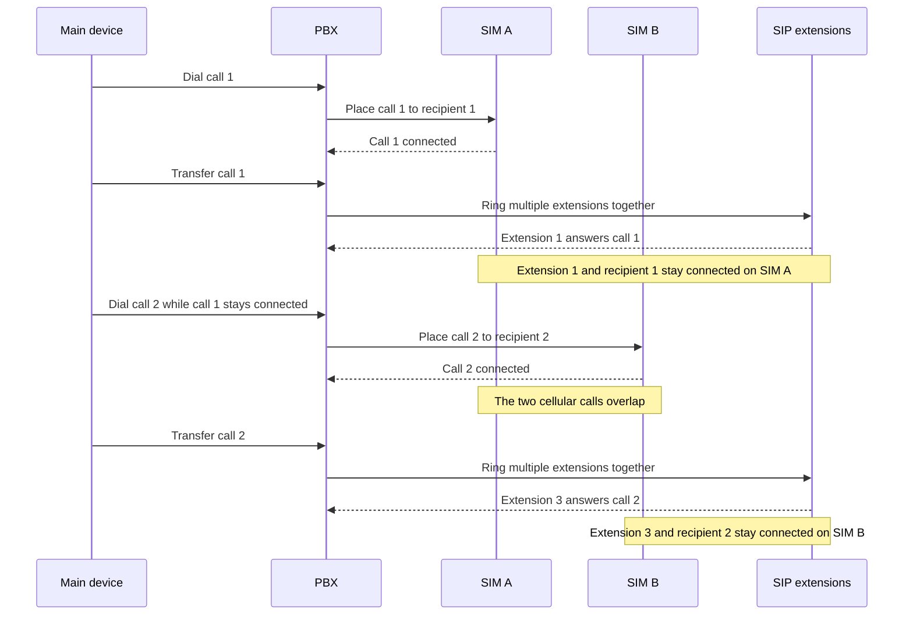

# SIP Communications Testing

Test results are scoped to the version, handset, and calling setup used for each check.

## Standalone APK checks

For `0.4.0-standalone.1`, the standalone and managed app suites each passed 131 tests. The SIP and gateway suites passed 22 and 20 tests respectively. The checks include manual SIP input validation, deferred settings updates, and the standalone permission gate.

The signed release package was checked for its ARM64 libraries, SIP account fields, Android package identifier, and 16 KiB ZIP alignment. The standalone package requests no SMS permissions. Phone installation, live PBX registration, and physical calls remain to be verified for this APK.

## Public source checks

On November 23, 2026, the following JVM tests passed against the public `0.4.0-yx.12` source snapshot.

| Suite | Passed | Failed |
| --- | ---: | ---: |
| SIP (`:sip:test`) | 22 | 0 |
| Gateway (`:gateway:test`) | 20 | 0 |

These suites cover the JVM SIP stack and call bridge. The public source check did not build an APK, install an update on a handset, or repeat physical calls.

A SIP socket shutdown test failed in an earlier CI run in the development history. The result above comes from a later run on the public source. That run does not establish the cause of the earlier failure.

## Reported handset tests

- The project owner reported successful physical call tests on **OPPO Reno10**, **OPPO Reno15**, and **vivo V60**. Exact Android builds and a complete scenario matrix were not recorded for all three devices.
- Earlier reports include two-way audio and normal hang-up with Linphone, recognition of in-call DTMF tones, and a two-way call through Bria with the compatibility audio settings.
- One-way audio has also been reported. A ringtone, test voice, or a ready indicator can establish part of the call path. Verify both directions with two people speaking during the same connected call.

## Single-app startup candidate

The separate `0.4.0-yx.15-rc1-test` candidate completed one outbound call with two-way audio on a **REDMI 15C**. It used an in-app startup flow for the privileged call service. The published `0.4.0-yx.12` source continues to use a separately installed Shizuku service.

Long calls, repeated calls, inbound cellular calls, reboot recovery, and other handsets remain to be checked for this candidate. [Implementation provenance](SOURCE_REVIEW.md)

## Multi-SIM and group transfer trial

The project owner reported the following live call test. The tested APK version was not recorded in the report. These results are listed separately from the public standalone APK checks above.

### Device setup

| Role | Phone |
| --- | --- |
| Main device | iPhone 13 |
| Extension 1 | iPhone 13 |
| Extension 2 | OPPO Reno15 |
| Extension 3 | vivo 1920 |
| SIM A | OPPO Reno10 |
| SIM B | REDMI 15C |
| SIM C | vivo V60 |

### Call sequence

### Reported results

| Check | Call 1 | Call 2 |
| --- | --- | --- |
| Cellular handset | SIM A | SIM B, selected while call 1 was active |
| Initial call | Normal audio reported | Normal audio reported |
| Group ringing | Multiple extensions rang together | Multiple extensions rang together |
| Answering extension | Extension 1 | Extension 3 |
| After transfer | Normal audio. Extension 1 and recipient 1 stayed connected through SIM A. | Normal audio. Extension 3 and recipient 2 stayed connected through SIM B. |

SIM C was present in the setup. Selection was observed on SIM A and SIM B in this trial. The report covers two calls, including the overlap between them.

## Device validation checklist

1. Record the app version, handset, Android build, Shizuku state, audio mode, and routing scenario. Keep account details and real telephone numbers out of shared notes.
2. Establish a call and have both parties speak. Verify both directions, listen for interruptions, and check that either end can hang up cleanly.
3. Transfer a call to a configured ringing group. Confirm that other group members stop ringing after one answers and that the original SIM remains busy until the call ends.
4. In a shared-line setup, hold the first call and confirm the PBX selects only another eligible, idle handset for the next call.
5. Check concurrent queued calls, declined or unanswered calls, timeout routing, and cleanup after a transfer.
6. Check handset output muting separately from call audio. Test network loss and background recovery before relying on that handset.
7. Verify that SMS survives a network interruption or account change until the expected acknowledgement arrives.

[Changelog](../CHANGELOG.md)
